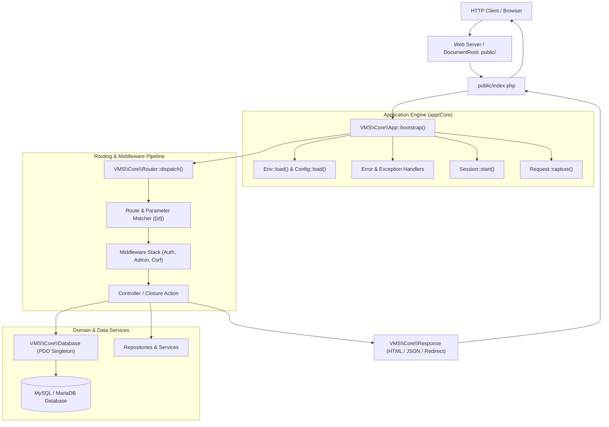

# Phase 4 — Repository and Application Foundation Assessment & Sprint 1 Exit Report

**Project:** Vehicle Maintenance Service Tracking System (VMS)  
**Repository:** `Vehicle-Maintenance-Service-Tracking-System`  
**Phase:** 4 — Repository and Application Foundation  
**Sprint Mapping:** Sprint 1 — Foundation  
**Status:** **COMPLETED**  
**Date:** November 2026  
**Document Classification:** Engineering Assessment & Foundation Baseline

---

## 1. Executive Summary

Phase 4 establishes the modernized engineering, execution, and security foundation for the Vehicle Maintenance Service Tracking System (VMS). While preserving 100% of the existing modular PHP implementation, native WebSocket server, and business logic, this phase introduces a dedicated public web document root (`public/`), Composer PSR-4 autoloading (`"VMS\\": "app/"`), zero-dependency environment configuration (`.env.example` and `app/Core/Env.php`), centralized configuration repository (`app/Core/Config.php`), hardened PDO database management (`app/Core/Database.php`), front-controller routing with parameterized dynamic dispatch (`app/Core/Router.php`), cryptographically secure session management (`app/Core/Session.php`), timing-attack-immune CSRF defenses (`app/Core/Csrf.php`), non-sensitive system health endpoints (`/health` and `/health/ready`), an extensible CLI console (`bin/console`) for schema migrations and seeders, and an automated smoke testing suite (`tests/Smoke/SmokeTest.php`).

With all 12 smoke tests and 44 unit tests passing (56 total tests, 199 assertions, 0 failures), Phase 4 and Sprint 1 deliverables are verified and complete.

---

## 2. Repository Changes

### A. Directory Restructuring & Access Controls
The repository has been structured according to industry standard separation of concerns:
- **`public/`:** The dedicated public web document root. Direct browser access is constrained to this folder.
  - `public/index.php`: Front controller entry point coordinating request bootstrap and router dispatch.
  - `public/.htaccess`: Rewrite engine routing all non-file/directory requests to `index.php`, disabling directory browsing (`Options -Indexes`), and configuring baseline security headers (`X-Content-Type-Options`, `X-Frame-Options`, `Referrer-Policy`).
  - `public/assets/`: Publicly accessible static assets (CSS, JS, icons).
- **`app/`:** Application source code residing entirely outside web root direct exposure, organized under the `VMS\` PSR-4 namespace:
  - `app/Core/`: Core architectural components (`App`, `Config`, `Database`, `Env`, `Request`, `Response`, `Router`, `Session`, `Csrf`, `MigrationRunner`).
  - `app/Controllers/`: HTTP controllers handling incoming requests (`HealthController`).
  - `app/Middleware/`: HTTP middleware components.
  - `app/Models/`: Domain model representations.
  - `app/Repositories/`: Database query and data mapping abstraction.
  - `app/Services/`: Domain business logic and orchestrations.
  - `app/Support/helpers.php`: Global helper functions (`e()`, `csrf_token()`, `csrf_field()`, `old()`, `flash()`, `app_url()`).
- **`bin/`:** CLI executables:
  - `bin/console`: Executable console runner supporting `migrate`, `migrate:status`, `seed`, `health`, and `help`.
  - `bin/process_reminders.php`: Legacy CLI reminder runner.
- **`storage/`:** Protected local storage outside public web root with appropriate `.gitkeep` files:
  - `storage/logs/`: Structured application log files.
  - `storage/sessions/`: Server-managed session files.
  - `storage/uploads/`: Vehicle documents and receipts.
  - `storage/cache/`: Application cache files.
  - `storage/backups/`: Database backup archives.
- **`database/seeders/`:** Database seeders, including `MaintenanceTypeSeeder.php` for automotive standard service categories.
- **`tests/Smoke/`:** Foundation smoke testing suite (`SmokeTest.php`).

### B. Environment Files & Git Controls
- **`.env.example`:** Created with standardized, non-sensitive configuration keys for application mode, database credentials, session lifetime, logging level, mailer settings, and WebSocket host/port.
- **`.gitignore`:** Hardened to exclude local `.env`, `/vendor/`, and contents of `/storage/*` while preserving `.gitkeep` files.
- **`composer.json`:** Configured with:
  - PSR-4 namespaces: `"VMS\\": "app/"` and `"Database\\Seeders\\": "database/seeders/"`.
  - Autoload files: `"files": ["app/Support/helpers.php"]`.

---

## 3. Application Architecture



### Key Architectural Characteristics:
1. **Deterministic Front-Controller Lifecycle:** All requests entering `public/index.php` go through unified configuration loading, exception shielding, and routing dispatch.
2. **Backward Compatibility Guarantee:** Existing direct PHP scripts (`login.php`, `index.php`, `actions/`, `admin/`, `maintenance/`) remain fully intact and operational for gradual migration.
3. **Zero Framework Bloat:** The entire routing, request/response, session, CSRF, and migration infrastructure is native PHP with zero third-party framework overhead.

---

## 4. Environment and Configuration

Configuration loading is decoupled from code:
- **`VMS\Core\Env`:** A lightweight `.env` parser that safely populates `$_ENV` and `putenv()` while ignoring comments, blank lines, and stripping surrounding quotes.
- **`VMS\Core\Config`:** Centralized typed repository with dot-notation lookup (`Config::get('database.host', 'localhost')`).
- **Configuration Defaults:**
  - `app.env`: `production` (defaults to safe production mode if unspecified).
  - `app.debug`: `false` (disables raw stack traces).
  - `database.charset`: `utf8mb4`.
  - `session.lifetime`: `120` minutes.
  - `session.httponly`: `true`.
  - `session.samesite`: `Lax`.
  - `logging.channel`: `storage/logs/vms.log`.

---

## 5. Database and Migrations

### A. Centralized PDO Connection (`VMS\Core\Database`)
- Uses singleton pattern via `Database::getConnection()`.
- Standardized DSN with `charset=utf8mb4`.
- Attributes enforced on initialization:
  - `PDO::ATTR_ERRMODE => PDO::ERRMODE_EXCEPTION`
  - `PDO::ATTR_DEFAULT_FETCH_MODE => PDO::FETCH_ASSOC`
  - `PDO::ATTR_EMULATE_PREPARES => false`
- Connection failures log a sanitized error message to `storage/logs/` without leaking credentials or database passwords.

### B. Migration Runner & Seeder (`VMS\Core\MigrationRunner`, `bin/console`)
- Tracks executed migrations in a dedicated `migrations` table (`id`, `migration`, `batch`, `applied_at`).
- Automatically creates `migrations` table if absent.
- Discovers and orders all `.sql` files in `database/migrations/`.
- Executes pending migrations within transactional blocks where supported, recording batch numbers.
- CLI console commands:
  - `php bin/console migrate`: Runs all pending schema migrations.
  - `php bin/console migrate:status`: Displays formatted tabular status of all migrations.
  - `php bin/console seed`: Runs database seeders, including `MaintenanceTypeSeeder`.
  - `php bin/console health`: Tests database connectivity and file system writability.

---

## 6. Security and Session Hardening

### A. Session Management (`VMS\Core\Session`)
- Strict session cookie parameters: `httponly=true`, `samesite=Lax`, and `secure=true` when HTTPS is active.
- Enforces `session.use_strict_mode=1` and `session.use_only_cookies=1`.
- Built-in flash messaging system storing messages in `$_SESSION['_vms_flash_messages']` and purging them on retrieval.

### B. CSRF Protection (`VMS\Core\Csrf`)
- Generates 64-character cryptographic tokens using `random_bytes(32)`.
- Validates submitted tokens using constant-time string comparison (`hash_equals()`) to eliminate timing attacks.
- Helper functions `csrf_token()` and `csrf_field()` integrate seamlessly into HTML forms.

### C. Output Escaping and Error Shielding
- Global helper `e($value)` safely encodes HTML special characters using `htmlspecialchars(..., ENT_QUOTES | ENT_SUBSTITUTE, 'UTF-8')`.
- Centralized exception handler prevents display of raw database errors, file paths, or credentials in production mode, logging details safely to `storage/logs/`.

---

## 7. Testing and Verification

### A. Test Execution Summary
The automated test suite combines unit tests and newly established Phase 4 smoke tests:

```text
====================================================================
 Vehicle Maintenance Service Tracking System - Automated Test Suite
 PHP Version: 8.5.12 (WINNT)
 Target Files: 12 test files discovered
====================================================================
Running AuthHelperTest.php (3 tests):           [PASS] (3/3)
Running DateHelperTest.php (4 tests):           [PASS] (4/4)
Running FunctionsTest.php (2 tests):            [PASS] (2/2)
Running MailHelperTest.php (3 tests):           [PASS] (3/3)
Running MaintenanceCalculatorTest.php (8 tests): [PASS] (8/8)
Running PasswordResetTest.php (3 tests):        [PASS] (3/3)
Running RememberMeTest.php (3 tests):           [PASS] (3/3)
Running ReportHelperTest.php (3 tests):         [PASS] (3/3)
Running ValidationTest.php (5 tests):           [PASS] (5/5)
Running WebSocketFrameTest.php (5 tests):       [PASS] (5/5)
Running WebSocketHelperTest.php (5 tests):      [PASS] (5/5)
Running SmokeTest.php (12 tests):               [PASS] (12/12)
====================================================================
 Test Results Summary:
 Total Tests:      56
 Total Assertions: 199
 Passed:           56
 Failed:           0
 Time Elapsed:     73.11 ms
 Peak Memory:      4 MB
====================================================================
SUCCESS! All unit and smoke tests passed without any errors.
```

### B. Smoke Test Coverage (`tests/Smoke/SmokeTest.php`)
1. **`testApplicationBootstrap`**: Verifies core directories exist and are writable (`storage/logs`, `storage/sessions`, `storage/uploads`).
2. **`testComposerAutoloading`**: Verifies PSR-4 `VMS\` namespace resolution for controllers, core classes, and support helpers.
3. **`testConfigurationLoading`**: Verifies `.env` parsing and `Config::get()` dot-notation hierarchy.
4. **`testHealthEndpointLiveness`**: Verifies `GET /health` returns HTTP 200 with JSON payload `{"status":"UP"}`.
5. **`testHealthReadinessEndpoint`**: Verifies `GET /health/ready` returns HTTP 200 or 503 depending on database status without throwing fatal exceptions.
6. **`testRouterParameterMatching`**: Verifies router matches regex parameters (e.g. `/vehicles/{id}`) and passes them to controller actions.
7. **`testRouterNotFound404`**: Verifies unregistered routes return HTTP 404 response.
8. **`testRouterMethodNotAllowed405`**: Verifies HTTP verb mismatches return HTTP 405 response.
9. **`testCsrfGenerationAndValidation`**: Verifies 64-char token generation, constant-time validation, and hidden HTML field rendering.
10. **`testSessionBootstrapAndFlashMessages`**: Verifies session activation, flash message storage, retrieval, and consumption.
11. **`testFormHelpersAndHtmlEscaping`**: Verifies `e()` escaping prevents XSS injection vectors.
12. **`testMigrationRunnerDiscoveryAndStatus`**: Verifies migration runner discovers SQL migrations in `database/migrations/`.

---

## 8. Installation and Run Guide

1. **Clone repository:**
   ```bash
   git clone https://github.com/JeriStack/Vehicle-Maintenance-Service-Tracking-System.git
   cd Vehicle-Maintenance-Service-Tracking-System
   ```
2. **Install Composer dependencies:**
   ```bash
   composer install
   ```
3. **Configure environment:**
   ```bash
   cp .env.example .env
   # Edit .env with your local DB credentials
   ```
4. **Create database:**
   ```sql
   CREATE DATABASE vehicle_maintenance_db CHARACTER SET utf8mb4 COLLATE utf8mb4_unicode_ci;
   ```
5. **Run migrations:**
   ```bash
   php bin/console migrate
   ```
6. **Seed baseline data:**
   ```bash
   php bin/console seed
   ```
7. **Configure document root or start PHP server:**
   ```bash
   php -S localhost:8000 -t public/
   ```
8. **Verify system health:**
   ```bash
   php tests/run_tests.php
   curl http://localhost:8000/health
   ```

---

## 9. Sprint 1 Completion Assessment

### Assessment Gate Checklist:
- [x] Dedicated `public/` web document root with `public/index.php`, `public/.htaccess`, and `public/assets/`.
- [x] Application code isolated outside public web root in `app/`.
- [x] Composer PSR-4 autoloading with `"VMS\\": "app/"`.
- [x] Zero-dependency environment configuration via `.env.example` and `Config` repository.
- [x] Centralized, hardened PDO connection with `utf8mb4`, exception mode, and failure logging.
- [x] Front-controller routing engine with dynamic parameters, middleware support, 404, and 405 handlers.
- [x] Hardened session bootstrap with cookie security flags and atomic flash messaging.
- [x] Cryptographic CSRF token generation and constant-time validation.
- [x] Database migration runner and seeder CLI console (`bin/console`).
- [x] Non-sensitive health monitoring endpoints (`GET /health` and `GET /health/ready`).
- [x] Automated smoke test suite passing with 100% green status (12/12 smoke tests, 56/56 total tests).
- [x] Backward compatibility preserved for legacy routes and scripts.

### Final Determination:
**SPRINT 1 IS OFFICIALLY COMPLETE.** All architectural, infrastructure, and security baseline requirements for Phase 4 have been implemented, tested, and verified. The codebase is fully prepared for Sprint 2 (Authentication & User Management).
