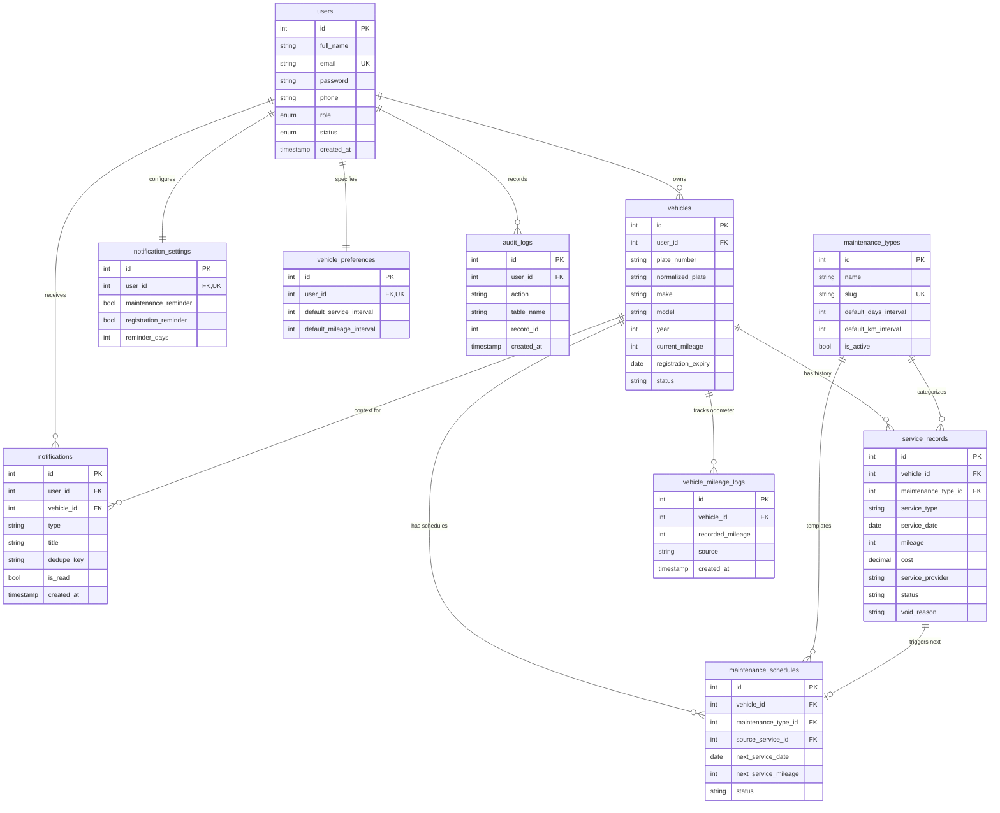

# Entity-Relationship Diagram (ERD) Specification
## Vehicle Maintenance Service Tracking System (VMS)

**Document ID:** VMS-DOC-DES-ERD-001  
**Phase:** 2 — Process Analysis and Technical Design  
**Authority:** VMS System Plan, Database Schema, Phase 1 Requirements Baseline  
**Status:** Approved Technical Design  
**Last Updated:** 2026-11-05  

---

## 1. Relational Architecture Overview

The VMS relational database model is designed around **ten core entities** optimized for high referential integrity, auditable data retention, owner-scoped isolation, and fast query performance under MySQL 8.0 and MariaDB 10.4 (InnoDB engine).



---

## 2. Ownership & Data Isolation Hierarchy

```text
USER (Parent Root Identity)
 │
 ├── notification_settings (1:1 Child)
 ├── vehicle_preferences   (1:1 Child)
 ├── notifications         (1:N Child)
 ├── audit_logs            (1:N Child)
 │
 └── VEHICLES (1:N Primary Domain Asset)
      │
      ├── vehicle_mileage_logs    (1:N Audit History)
      ├── service_records         (1:N Completed Invoices & Records)
      └── maintenance_schedules   (1:N Future Target Projections)
```

### Invariant:
Every query accessing vehicle, service, schedule, or mileage data must traverse the ownership path:
$$\text{Data Resource} \longrightarrow \text{Vehicle} \longrightarrow \text{user\_id} = \$_SESSION['user\_id']$$
Direct access to any child record whose parent vehicle does not belong to the current authenticated user results in immediate authorization rejection (`HTTP 403 Forbidden`).

