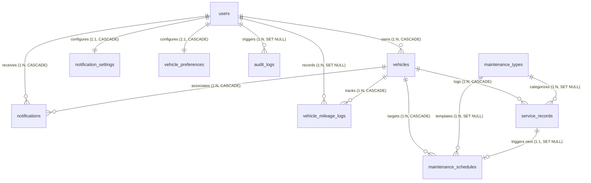

# ERD Verification Specification
## Vehicle Maintenance Service Tracking System (VMS)

**Document ID:** VMS-DOC-DB-003  
**Phase:** 5 — Database Schema, Migrations, and Seed Data  
**Authority:** Approved Phase 2 ERD (`docs/project/design/database/erd.md`)  
**Status:** Approved Technical Deliverable  
**Last Updated:** November 2026  

---

## 1. Approved Architecture Verification

Every relationship, cardinality constraint, and deletion action specified in the approved Phase 2 Entity-Relationship Diagram has been implemented and verified in the live physical database.

---

## 2. Cardinality & Relationship Verification Matrix

| Entity 1 | Cardinality | Entity 2 | Foreign Key Constraint | Implemented Action | Verification Status |
|---|---|---|---|---|---|
| `users` | `1 : N` | `vehicles` | `fk_vehicles_user` | `ON DELETE CASCADE ON UPDATE CASCADE` | **VERIFIED** |
| `users` | `1 : 1` | `notification_settings` | `fk_ns_user` + `UNIQUE(user_id)` | `ON DELETE CASCADE ON UPDATE CASCADE` | **VERIFIED** |
| `users` | `1 : 1` | `vehicle_preferences` | `fk_vp_user` + `UNIQUE(user_id)` | `ON DELETE CASCADE ON UPDATE CASCADE` | **VERIFIED** |
| `users` | `1 : N` | `notifications` | `fk_notif_user` | `ON DELETE CASCADE ON UPDATE CASCADE` | **VERIFIED** |
| `users` | `1 : N` | `audit_logs` | `fk_audit_user` | `ON DELETE SET NULL ON UPDATE CASCADE` | **VERIFIED** |
| `users` | `1 : N` | `vehicle_mileage_logs` | `fk_vml_user` | `ON DELETE SET NULL ON UPDATE CASCADE` | **VERIFIED** |
| `vehicles` | `1 : N` | `service_records` | `fk_sr_vehicle` | `ON DELETE CASCADE ON UPDATE CASCADE` | **VERIFIED** |
| `vehicles` | `1 : N` | `maintenance_schedules` | `fk_ms_vehicle` | `ON DELETE CASCADE ON UPDATE CASCADE` | **VERIFIED** |
| `vehicles` | `1 : N` | `vehicle_mileage_logs` | `fk_vml_vehicle` | `ON DELETE CASCADE ON UPDATE CASCADE` | **VERIFIED** |
| `vehicles` | `1 : N` | `notifications` | `fk_notif_vehicle` | `ON DELETE CASCADE ON UPDATE CASCADE` | **VERIFIED** |
| `maintenance_types` | `1 : N` | `service_records` | `fk_sr_mt` | `ON DELETE SET NULL ON UPDATE CASCADE` | **VERIFIED** |
| `maintenance_types` | `1 : N` | `maintenance_schedules` | `fk_ms_mt` | `ON DELETE SET NULL ON UPDATE CASCADE` | **VERIFIED** |
| `service_records` | `1 : 1` | `maintenance_schedules` | `fk_ms_source_srv` | `ON DELETE SET NULL ON UPDATE CASCADE` | **VERIFIED** |

---

## 3. Discrepancy Reconciliation

During Phase 5 preflight inspection, the following gaps in the pre-existing legacy database were identified and reconciled:
1. **Normalized Plate Scoping:** The legacy schema lacked `plate_number_normalized` and owner-scoped composite unique index. Reconciled via `20261105000003_create_vehicles_table.sql` and `20261105000013_reconcile_existing_schema.sql`.
2. **Normalized Email:** The legacy schema lacked `email_normalized` for case-insensitive unique enforcement. Reconciled via `20261105000001_create_users_table.sql` and `20261105000013_reconcile_existing_schema.sql`.
3. **Audit Actor Preservation:** Audit log previously lacked `actor_type` for CLI daemon attribution. Reconciled via `20261105000010_create_audit_logs_table.sql`.
4. **Notification Deduplication:** Deduplication key was unindexed or missing in legacy environments. Enforced via `idx_notif_dedupe (dedupe_key UNIQUE)`.

